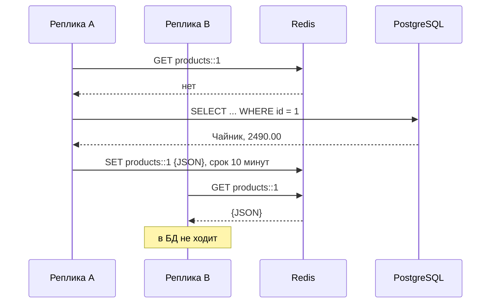

# Сценарий 1. `RedisCacheManager` и сериализация

Тест: `src/test/java/io/github/olaaa/distributedcachelab/scenario/Scenario1RedisCacheManagerTest.java`.
Сервисы: `RedisCacheableProductService` (кэш `products`), `DefaultConfigProductService` (кэш `productsDefault`). Настройка: `config/CacheConfiguration`.
Ручная проверка: `http/01-redis-cache-manager.http`.

## Ситуация

Каталог магазина работает в нескольких репликах за балансировщиком. В caching-lab кэш был локальным, на Caffeine: у каждой реплики своя копия. Отсюда три проблемы:

- каждая реплика загружает один и тот же товар из БД сама: десять реплик — десять промахов на один товар;
- после перезапуска реплика стартует с пустым кэшем;
- реплики могут отдавать разные версии одного товара, пока их копии не истекут.

Общий кэш в Redis решает все три: одна загрузка на все реплики, данные переживают перезапуск приложения, и все реплики читают одну копию.

## Как это работает

```java
@Cacheable(CACHE_NAME)
public Mono<Product> findById(long id) {
    return source.load(id);
}
```

Код сервиса такой же, как в caching-lab. Меняется только `CacheManager`. Когда в зависимостях есть Spring Data Redis, Spring Boot сам создаёт `RedisCacheManager`: в порядке поиска провайдеров Redis стоит раньше Caffeine и раньше простого кэша на `ConcurrentHashMap`.



Ключ в Redis — имя кэша, два двоеточия и ключ кэша: `products::1`. Так его строит `CacheKeyPrefix.simple()`, префикс по умолчанию.

Для методов, которые возвращают `Mono`, Spring читает кэш асинхронно, через `Cache.retrieve`. `RedisCache` это умеет, только если фабрика соединений реактивная. В исходнике `DefaultRedisCacheWriter` (Spring Data Redis 4.1.2) асинхронный режим включается так:

```java
if (REACTIVE_REDIS_CONNECTION_FACTORY_PRESENT && this.connectionFactory instanceof ReactiveRedisConnectionFactory) {
    this.asyncCacheWriter = new AsynchronousCacheWriterDelegate();
}
```

Реактивную фабрику даёт клиент Lettuce. Его по умолчанию приносит `spring-boot-starter-data-redis-reactive`. С Jedis реактивного режима нет, и `@Cacheable` на `Mono` с `RedisCache` не заработает.

## Настройки по умолчанию

Если кэш никак не настроен, Spring Boot создаёт его по `RedisCacheConfiguration.defaultCacheConfig()` и заменяет сериализатор значений на `JdkSerializationRedisSerializer`:

| Параметр | По умолчанию | Кэш `products` в сценарии |
|---|---|---|
| Сериализация значения | JDK-сериализация, двоичный формат | JSON через `JacksonJsonRedisSerializer<Product>` |
| Срок жизни | вечно | 10 минут, `entryTtl` |
| `null` | кэшируется | не кэшируется, `disableCachingNullValues` |
| Префикс ключа | имя кэша и `::` | так же |

Общие настройки задаются свойствами `spring.cache.redis.*` (`time-to-live`, `cache-null-values`, `key-prefix`, `use-key-prefix`), а настройки отдельного кэша — через `RedisCacheManagerBuilderCustomizer`. Так сделано в `CacheConfiguration`:

```java
public static RedisCacheConfiguration productsCacheConfiguration() {
    return RedisCacheConfiguration.defaultCacheConfig()
            .entryTtl(PRODUCTS_TTL)
            .disableCachingNullValues()
            .serializeValuesWith(SerializationPair.fromSerializer(new JacksonJsonRedisSerializer<>(Product.class)));
}

@Bean
RedisCacheManagerBuilderCustomizer productsCacheCustomizer() {
    return builder -> builder.withCacheConfiguration(RedisCacheableProductService.CACHE_NAME,
            productsCacheConfiguration());
}
```

## Сериализация: что выбрать

В Caffeine лежит сам объект. В Redis — байты, поэтому объект надо превратить в байты и обратно. От выбора сериализатора зависят совместимость между версиями приложения, безопасность и то, можно ли прочитать значение глазами.

- **`JdkSerializationRedisSerializer` (по умолчанию).** Стандартная сериализация Java. Класс обязан реализовать `Serializable`. Формат двоичный: в `redis-cli` не прочитать, другим языком не прочитать. Привязан к классу Java: переименовала пакет или поле — старые записи не прочитаются. Десериализация чужих байтов через механизм JDK — известный источник уязвимостей.
- **`JacksonJsonRedisSerializer<T>` с конкретным типом.** JSON без служебных полей: `{"id":1,"name":"Чайник","price":2490.00}`. Тип известен заранее, поэтому Jackson создаёт только `Product`. Один кэш — один тип значения. Выбран в сценарии.
- **`GenericJacksonJsonRedisSerializer`.** JSON для значений любого типа в одном кэше. Чтобы потом прочитать, в JSON пишется имя класса (default typing), и тут нужна осторожность. Про `enableUnsafeDefaultTyping` Javadoc предупреждает: «without restrictions of the PolymorphicTypeValidator deserialization is vulnerable to arbitrary code execution when reading from untrusted sources». Если без него никак — `enableDefaultTyping(validator)` со списком разрешённых пакетов.

`GenericJackson2JsonRedisSerializer` и `Jackson2JsonRedisSerializer` — то же для Jackson 2. В Spring Data Redis 4 они помечены `@Deprecated(since = "4.0", forRemoval = true)`: Spring Boot 4 работает с Jackson 3, и нужны классы без «2» в имени.

## Ловушка: настройки по умолчанию и record

```java
@Cacheable(CACHE_NAME)   // productsDefault — без своей настройки
public Mono<Product> findById(long id) {
    return source.load(id);
}
```

`Product` — record, `Serializable` он не реализует. JDK-сериализатор от него отказывается: в `JdkSerializationRedisSerializer`

```java
public boolean canSerialize(Class<?> type) {
    return RedisSerializer.super.canSerialize(type) && Serializable.class.isAssignableFrom(type);
}
```

и запись в кэш падает с `IllegalStateException: Cannot serialize value of type ...Product without a serializer`. Ошибка не остаётся внутри кэша: `@Cacheable` пробрасывает её в `Mono`, и клиент получает 500, хотя товар из БД уже прочитан. Ни при старте приложения, ни при компиляции это не видно — только на первой записи в кэш.

Это частая ошибка при переходе с Caffeine на Redis: с Caffeine тот же код работал, потому что Caffeine хранит объект и ничего не сериализует.

## Что проверяют тесты

`cacheableOnMonoStoresValueInRedis`: пять чтений — одно обращение к источнику, ключ `products::1` есть в Redis.

`valueIsStoredAsReadableJson`: значение по ключу — ровно `{"id":1,"name":"Чайник","price":2490.00}`.

`entryExpiresAfterConfiguredTimeToLive`: у ключа есть срок жизни, от 9 до 10 минут.

`anotherReplicaReadsCachedValueWithoutSource`: вторая реплика — отдельный `RedisCacheManager` с той же настройкой и тем же Redis — получает товар из кэша. Обращений к источнику по-прежнему одно.

`defaultJdkSerializationBreaksReadOfNonSerializableRecord`: чтение через кэш с настройками по умолчанию заканчивается `IllegalStateException`. Обращение к источнику при этом было, а ключа `productsDefault::1` в Redis нет.

Тесты поднимают Redis в контейнере Testcontainers. Отдельного модуля не нужно: Spring Boot узнаёт `GenericContainer` с образом `redis` и сам выставляет адрес подключения (`@ServiceConnection(name = "redis")`).

## Попробовать вручную

Запустить приложение: `mvn spring-boot:run` (PostgreSQL и Redis поднимутся из `compose.yaml`). Открыть `http/01-redis-cache-manager.http`:

1. `POST /lab/reset` — сбросить счётчик и очистить Redis.
2. Несколько раз `GET /products/1?via=REDIS`, затем `GET /lab/stats` — `sourceCalls` равно 1.
3. `GET /products/1?via=REDIS_DEFAULT_CONFIG` — ответ 500.

Посмотреть, что лежит в Redis:

```bash
docker compose exec redis redis-cli KEYS '*'
docker compose exec redis redis-cli GET products::1
docker compose exec redis redis-cli TTL products::1
```

`GET` вернёт JSON, `TTL` — оставшиеся секунды, около 600. Перезапусти приложение и снова запроси товар: товар придёт из Redis, `sourceCalls` останется 0 (проверено).

## Что важно заметить

- Код сервиса не изменился — изменились хранилище и настройка. Поэтому проблемы Redis-кэша видны не в коде, а в конфигурации: сериализатор, срок жизни, `null`.
- По умолчанию запись в Redis живёт вечно. Без `entryTtl` или `spring.cache.redis.time-to-live` кэш растёт, пока Redis не упрётся в `maxmemory`.
- Сеть: каждое чтение кэша — запрос в Redis. Это быстрее БД, но медленнее Caffeine. Отсюда двухуровневый кэш — тема 3 этапа.
- `@Cacheable(sync = true)` с `RedisCache` одновременные промахи не объединяет: `RedisCache.retrieve(key, valueLoader)` сначала читает, а при промахе вызывает загрузчик и пишет, без блокировки. Проверено в [сценарии 6](06-stampede.md): 50 одновременных промахов — 50 загрузок.

## Как сказать на собеседовании

«Чтобы кэш был общим для реплик и переживал перезапуск, беру Redis через `RedisCacheManager` — код с `@Cacheable` не меняется. Первым делом настраиваю сериализацию и срок жизни: по умолчанию Spring Boot пишет JDK-сериализацией, а запись живёт вечно. Беру JSON с конкретным типом — `JacksonJsonRedisSerializer<T>`: читается глазами, не зависит от `Serializable` и не открывает десериализацию произвольных классов. Для реактивного `@Cacheable` нужен Lettuce: асинхронное чтение `RedisCache` работает только с реактивной фабрикой соединений».

## Источники

- Spring Boot — [Caching: Redis](https://docs.spring.io/spring-boot/reference/io/caching.html) и [Redis](https://docs.spring.io/spring-boot/reference/data/nosql.html).
- Spring Data Redis 4.1.2, исходники: `RedisCacheConfiguration.defaultCacheConfig`, `RedisCache.retrieve`, `DefaultRedisCacheWriter`, `JdkSerializationRedisSerializer.canSerialize`, `GenericJacksonJsonRedisSerializer`.
- Spring Boot 4.1.2, исходники: `org.springframework.boot.cache.autoconfigure.RedisCacheConfiguration`, `RedisContainerConnectionDetailsFactory`.
