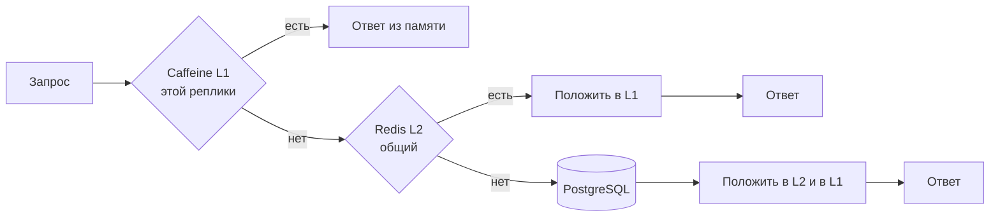

# Сценарий 3. Двухуровневый кэш: Caffeine плюс Redis

Тест: `src/test/java/io/github/olaaa/distributedcachelab/scenario/Scenario3TwoLevelCacheTest.java`.
Сервис: `TwoLevelProductService` (`LOCAL_TTL` = 30 секунд, `REDIS_TTL` = 10 минут). Настройка: `config/TwoLevelCacheConfiguration`.
Ручная проверка: `http/03-two-level-cache.http` и команды `redis-cli` ниже.

Уровни кэша обозначают L1 и L2 (level 1, level 2), как кэши процессора: L1 — ближе и быстрее, но меньше и у каждого свой, L2 — дальше, но общий.

## Ситуация

После сценария 1 кэш общий для всех реплик, но каждое чтение — сетевой запрос в Redis. Для большинства данных это нормально: Redis намного быстрее базы. Но карточку популярного товара на распродаже читают тысячи раз в секунду, и каждая реплика тысячи раз в секунду ходит в Redis за одним и тем же значением. Это сетевые задержки на каждом запросе и нагрузка на Redis.

Двухуровневый кэш добавляет перед Redis локальный Caffeine в каждой реплике. Повторные чтения отдаёт Caffeine из памяти, без сети, а Redis остаётся общей копией для всех реплик и для перезапусков.

## Как это работает



```java
public Mono<Product> findById(long id) {
    return Mono.fromFuture(() -> localCache.get(id,
                    (key, executor) -> loadFromRedisOrSource(key).toFuture()),
            true);
}

private Mono<Product> loadFromRedisOrSource(long id) {
    String redisKey = REDIS_KEY_PREFIX + id;
    return Mono.defer(() -> {
                redisReads.incrementAndGet();
                return redis.opsForValue().get(redisKey);
            })
            .switchIfEmpty(Mono.defer(() -> source.load(id)
                    .flatMap(product -> redis.opsForValue().set(redisKey, product, REDIS_TTL)
                            .thenReturn(product))));
}
```

1. Первый уровень — `AsyncCache` Caffeine, как в caching-lab. При промахе он вызывает загрузчик, а загрузчик идёт во второй уровень.
2. Второй уровень — Redis через `ReactiveRedisTemplate<String, Product>` с тем же JSON, что у кэша `products` из сценария 1. Если в Redis значения нет — источник, затем запись в Redis с `REDIS_TTL`.
3. Значение, которое вернул загрузчик, `AsyncCache` кладёт в первый уровень сам.

`AsyncCache` кладёт в первый уровень future загрузки сразу, поэтому одновременные промахи на одной реплике ждут одну загрузку: в Redis и в источник идёт один запрос (сценарий 6 в caching-lab). Между репликами такого объединения нет: если десять реплик промахнулись одновременно, в Redis пойдут десять запросов, а если и там пусто — десять загрузок из источника.

`Mono.defer` внутри `switchIfEmpty` — защита, а не необходимость. Аргумент `switchIfEmpty` Java вычисляет при сборке цепочки (разбор «Project Reactor: момент сборки цепочки и момент подписки», раздел 2.4), поэтому без `defer` метод `source.load(id)` вызывался бы и тогда, когда товар нашёлся в Redis. С нынешним `ProductSource` это безвредно: его тело само завёрнуто в `Mono.defer`, вызов только собирает описание, а счётчик, флаг сбоя и `SELECT` сработают лишь при подписке — то есть при промахе в Redis. Проверено: без `defer` здесь все тесты сценария проходят. `defer` оставлен, чтобы этот метод не полагался на то, что чужой `load` ленивый.

## Почему не `@Cacheable`

В Spring нет готового двухуровневого `CacheManager`. `CompositeCacheManager` похож по названию, но слоёв не строит: его `getCache` перебирает менеджеры и возвращает кэш первого, который знает это имя. Javadoc: «Composite CacheManager implementation that iterates over a given collection of delegate CacheManager instances». То есть значение лежит либо в Caffeine, либо в Redis, а не в обоих. Двухуровневый кэш пишут вручную, как здесь, или своей реализацией `Cache`, которая внутри обращается к двум уровням.

## Сроки уровней

- **`REDIS_TTL` = 10 минут** — как в сценарии 1: сколько общая копия может отставать от базы, если об изменении никто не сказал.
- **`LOCAL_TTL` = 30 секунд** — сколько копия этой реплики может отставать от Redis. Другая реплика обновила товар и записала новое значение в Redis — эта реплика узнает об этом только когда истечёт её локальная копия.

Поэтому срок первого уровня делают коротким: он и есть цена двухуровневого кэша. Даже 30 секунд дают большую часть выигрыша: горячий товар, который читают тысячу раз в секунду, за 30 секунд прочитают 30 000 раз, а в Redis реплика сходит один раз. Длинный срок первого уровня возможен только вместе с рассылкой об изменениях между репликами — это сценарий 4.

## Что проверяют тесты

`firstReadGoesThroughRedisToSourceAndFillsBothLevels`: первое чтение — одно обращение к Redis (там промах) и одно к источнику, после чего ключ `productsTwoLevel::1` есть в Redis.

`repeatedReadsAreServedLocallyWithoutRedis`: десять чтений — одно обращение к источнику и одно к Redis. Девять повторных отдал Caffeine.

`anotherReplicaGetsValueFromRedisNotFromSource`: вторая реплика — отдельный `TwoLevelProductService` со своим Caffeine, но тем же Redis. Реплика A прочитала товар, реплика B пять раз прочитала его же: обращений к источнику по-прежнему одно, реплика B сходила в Redis один раз.

`localCopyStaysStaleUntilLocalTimeToLiveExpires`:

1. Реплика A прочитала товар, он лёг в оба уровня.
2. «Другая реплика» записала в Redis новую цену 1990.00.
3. Реплика A отвечает старой ценой 2490.00 — из своего Caffeine.
4. `ManualTicker` сдвигается на `LOCAL_TTL` плюс секунда — локальная копия истекла.
5. Реплика A отвечает новой ценой из Redis. Обращений к источнику — одно за весь тест, к Redis — два.

Сроки первого уровня двигает `ManualTicker`, как в caching-lab. Срок в Redis он не двигает: его считают часы самого Redis.

## Сколько экономит первый уровень

Замер: 1000 повторных чтений «Чайника» подряд, когда он уже в кэше. Сравнивается кэш только в Redis из сценария 1 и двухуровневый кэш. Redis в Docker на ноутбуке, три прогона.

| Прогон | Только Redis, на чтение | Двухуровневый, на чтение | Обращений к Redis у двухуровневого |
|---|---|---|---|
| 1 | 660 мкс | 3,9 мкс | 1 |
| 2 | 481 мкс | 1,7 мкс | 1 |
| 3 | 448 мкс | 0,9 мкс | 1 |

Разница — два порядка. В сети дата-центра задержка до Redis будет другой, но сетевой запрос всё равно останется на порядки медленнее чтения из памяти процесса (вывод, не замер).

## Попробовать вручную

Запустить приложение: `mvn spring-boot:run`. Открыть `http/03-two-level-cache.http`:

1. `POST /lab/reset`.
2. Несколько раз `GET /products/1?via=TWO_LEVEL`, затем `GET /lab/stats`: `sourceCalls` = 1, `twoLevelRedisReads` = 1.

Устаревание первого уровня — на настоящих часах. Записать в Redis другую цену в обход приложения:

```bash
docker compose exec redis redis-cli SET productsTwoLevel::1 '{"id":1,"name":"Чайник","price":1990.00}' EX 600
```

Сразу после этого `GET /products/1?via=TWO_LEVEL` вернёт старую цену 2490.00 — из Caffeine. Через 30 секунд после первого чтения — новую цену 1990.00 из Redis.

## Что важно заметить

- Первый уровень ускоряет чтение и разгружает Redis, но возвращает проблему локального кэша: у каждой реплики своя копия, и копии расходятся. Двухуровневый кэш — компромисс между скоростью и свежестью, и регулирует его `LOCAL_TTL`.
- Память: каждая реплика держит свою копию горячих данных. `maximumSize` у Caffeine обязателен.
- Сценарий 4 — как сократить расхождение: сообщать остальным репликам об изменении, чтобы они удаляли свою локальную копию сразу, а не ждали `LOCAL_TTL`.

## Как сказать на собеседовании

«Когда горячие ключи читают тысячи раз в секунду, ставлю перед Redis локальный Caffeine в каждой реплике: повторные чтения идут из памяти, без сети, — в нашем замере 1–4 микросекунды против полмиллисекунды. Redis остаётся общей копией. Цена — копии реплик расходятся: реплика не узнает об изменении, пока не истечёт её локальный срок, поэтому он короткий, секунды или десятки секунд. Если нужна свежесть быстрее — рассылаю инвалидацию между репликами через pub/sub. В Spring готового двухуровневого `CacheManager` нет, `CompositeCacheManager` — это перебор менеджеров, а не уровни».

## Источники

- Spring Framework 7.0.10, исходники: `CompositeCacheManager`.
- Spring Data Redis 4.1.2: `ReactiveRedisTemplate`, `RedisSerializationContext`, `JacksonJsonRedisSerializer`.
- Caffeine: `AsyncCache`, `Caffeine.ticker`, `expireAfterWrite` — подробно в caching-lab (`docs/caffeine-loader.md`).
