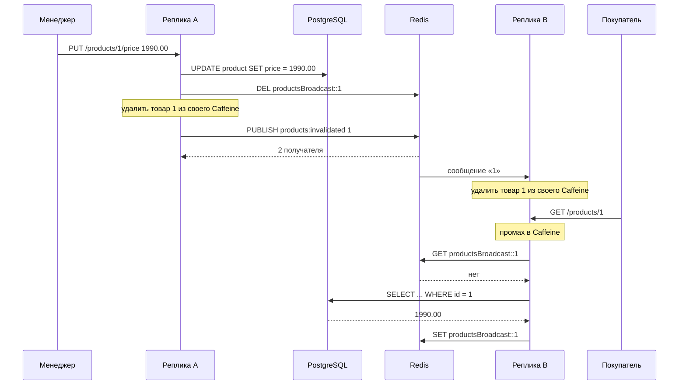

# Сценарий 4. Инвалидация локальных кэшей между репликами

Тест: `src/test/java/io/github/olaaa/distributedcachelab/scenario/Scenario4BroadcastInvalidationTest.java`.
Сервис: `BroadcastInvalidationProductService` (`LOCAL_TTL` = 30 секунд, `REDIS_TTL` = 10 минут, канал `products:invalidated`).
Ручная проверка: `http/04-broadcast-invalidation.http` — на двух запущенных репликах.

Инвалидация (invalidation) — пометка копии в кэше как недействительной: здесь её просто удаляют, и следующее чтение идёт за свежим значением. Pub/Sub (publish/subscribe, «публикация и подписка») — рассылка сообщения всем, кто подписан на канал.

## Ситуация

Сценарий 3 закончился ценой двухуровневого кэша: менеджер снизил цену, реплика A записала новое значение, а реплики B, C и D ещё до 30 секунд отдают старую цену из своего Caffeine. Покупатель обновляет страницу и видит то одну цену, то другую — в зависимости от того, на какую реплику попал запрос.

Задача — чтобы после изменения все реплики перестали отдавать старую копию сразу, а не через `LOCAL_TTL`. Для этого реплика, которая изменила товар, сообщает остальным: «товар 1 изменился, удалите свою копию». Канал для сообщений уже есть — Redis Pub/Sub.

## Как это работает



Чтение — как в сценарии 3: Caffeine, затем Redis, затем база. Новое — две части.

**Подписка.** Каждая реплика при старте подписывается на канал `products:invalidated` и, получив id товара, удаляет его из своего Caffeine:

```java
this.listenerContainer = new ReactiveRedisMessageListenerContainer(connectionFactory);
this.subscription = listenerContainer.receiveLater(INVALIDATION_TOPIC)
        .doOnNext(messages -> subscribed = true)
        .flatMapMany(messages -> messages)
        .subscribe(message -> onInvalidation(Long.parseLong(message.getMessage())));
```

`receiveLater` отдаёт поток сообщений, когда подписка уже действует. Javadoc: «Возвращённый Mono завершается, как только соединение подписано на заданные каналы». До этого момента сообщения, опубликованные в канал, реплика не получит — тесты поэтому ждут `isSubscribed()`, прежде чем менять цену.

Контейнер держит одно соединение на всё время жизни: «контейнер выделяет одно соединение при создании и освобождает его в destroy()». У каждой реплики свой контейнер — своё соединение, как у отдельного процесса.

**Изменение.** Реплика, которая меняет цену:

```java
public Mono<PriceChangeResult> changePrice(long id, BigDecimal price) {
    return repository.updatePrice(id, price)
            .flatMap(updatedRows -> {
                if (updatedRows == 0) {
                    return Mono.just(new PriceChangeResult(false, 0));
                }
                return redis.delete(REDIS_KEY_PREFIX + id)
                        .then(Mono.fromRunnable(() -> localCache.synchronous().invalidate(id)))
                        .then(stringRedis.convertAndSend(INVALIDATION_TOPIC.getTopic(), String.valueOf(id)))
                        .map(notifiedReplicas -> new PriceChangeResult(true, notifiedReplicas));
            });
}
```

1. `UPDATE` в базе. Без явной транзакции он коммитится сразу.
2. Удалить значение из Redis — общий второй уровень.
3. Удалить из своего Caffeine — не ждать собственного сообщения.
4. `PUBLISH` id товара в канал. Сообщение получат все подписанные реплики, включая эту же.

Порядок важен: когда реплика B получит сообщение, в Redis старого значения уже нет, и её следующее чтение дойдёт до базы. Если бы рассылка шла раньше удаления из Redis, B удалила бы свою копию и тут же взяла бы старое значение из Redis обратно.

Рассылается id, а не новое значение, по той же причине, что в сценарии 5 caching-lab удаляют, а не обновляют: если два менеджера почти одновременно меняют цену, сообщения с новыми значениями могут прийти в разном порядке, и реплики разойдутся. Удаление такой гонки не создаёт: следующее чтение возьмёт то, что действительно лежит в базе.

`PUBLISH` возвращает число получателей. Документация Redis: «число клиентов, которым отправлено сообщение. В Redis Cluster в это число входят только клиенты, подключённые к тому же узлу, что и публикующий клиент». Сервис отдаёт это число в ответе `notifiedReplicas` — по нему видно, сколько реплик сейчас подписаны.

## Pub/Sub доставляет не больше одного раза

Документация Redis: «Pub/Sub в Redis доставляет сообщения не больше одного раза. … Если подписчик не может обработать сообщение (например, из-за ошибки или обрыва сети), сообщение потеряно навсегда».

Реплика, у которой в момент рассылки оборвалась связь с Redis, перезапускалась или ещё не успела подписаться, сообщение не получит — и не получит никогда. Её локальная копия останется старой. Поэтому короткий `LOCAL_TTL` остаётся и после рассылки: это страховка, которая исправит потерянную инвалидацию сама. Рассылка сокращает расхождение в обычном случае до миллисекунд, `LOCAL_TTL` ограничивает его в худшем.

Что делают в продакшене, чтобы потерю сократить:

- **Очищать локальный кэш при обрыве подписки.** Так советует документация Redis для клиентских кэшей: «Если соединение потеряно, обязательно очистите локальный кэш». Реплика, которая не может получать инвалидации, не должна доверять своим копиям. В лаборатории этого нет нарочно: иначе не было бы видно потерю сообщения.
- **Redis Streams вместо Pub/Sub**, если инвалидации нельзя терять: документация Redis указывает на Streams для «более сильных гарантий доставки» — сообщения в потоке хранятся, и отставшая реплика может их дочитать. Цена — больше кода: группы потребителей, подтверждения, чистка потока.
- **Готовый механизм вместо своего кода** — `RLocalCachedMap` из Redisson: локальная копия, хеш в Redis и инвалидация через Pub/Sub, плюс `ReconnectionStrategy.CLEAR` на случай обрыва. Разобран в репозитории [redisson-cache-lab](https://github.com/olaaa/redisson-cache-lab), сценарий 1.
- **Отслеживание ключей самим Redis** (client-side caching, режим Tracking): Redis сам помнит, какие ключи читал клиент, и присылает инвалидации при их изменении. Тогда реплике не нужно рассылать сообщения самой. Это отдельная возможность Redis 6+, в лаборатории не разбирается.

## Что проверяют тесты

`priceChangeOnOneReplicaInvalidatesLocalCopyOnAnother`:

1. Реплика A — бин сервиса, реплика B — второй экземпляр со своим Caffeine и своим соединением подписки. Обе прочитали товар: обращение к источнику одно.
2. A меняет цену. `PUBLISH` вернул 2 — сообщение получили обе.
3. B получила одно сообщение и сразу, без сдвига часов, отдаёт новую цену 1990.00.
4. A тоже отдаёт новую цену. Обращений к источнику за тест — два: B загрузила новую цену из базы и положила в Redis, A взяла её из Redis.

`replicaThatMissedMessageStaysStaleUntilLocalTimeToLive`:

1. Три реплики A, B, C прочитали товар.
2. У B «оборвалась связь»: подписка закрыта.
3. A меняет цену. `PUBLISH` вернул 2 — сообщение получили A и C.
4. C отдаёт новую цену, B — старую 2490.00: сообщение потеряно.
5. `ManualTicker` сдвигается на `LOCAL_TTL` плюс секунда — копия B истекла, B отдаёт новую цену из Redis.

Тест сценария 4 прогнан пять раз подряд без единого падения: сообщения доставляются асинхронно, поэтому проверки после рассылки ждут получения через `await`, а не рассчитывают на мгновенную доставку.

## Попробовать вручную

Нужны две реплики. Запустить первую как обычно, вторую — на другом порту в соседнем терминале:

```bash
mvn spring-boot:run
mvn spring-boot:run -Dspring-boot.run.arguments=--server.port=8081
```

Вторая реплика подключится к тем же PostgreSQL и Redis из `compose.yaml`: их уже подняла первая. Остановка второй реплики контейнеры не гасит (проверено).

`http/04-broadcast-invalidation.http`:

1. Сброс на обеих репликах.
2. Товар 1 через `BROADCAST` на 8080 и на 8081 — обе положили его в свой Caffeine.
3. `PUT /products/1/price` на 8080 с ценой 1990.00 — ответ `{"updated":true,"notifiedReplicas":2}`.
4. Товар 1 на 8081 — сразу 1990.00. В `GET /lab/stats` на 8081 `broadcastInvalidationsReceived` = 1.
5. Вернуть цену 2490.00.

Результат такого прогона на двух репликах:

```text
change on A: {"updated":true,"notifiedReplicas":2}
B read: {"id":1,"name":"Чайник","price":1990.00}
A stats: {"sourceCalls":1,"twoLevelRedisReads":0,"broadcastInvalidationsReceived":1}
B stats: {"sourceCalls":1,"twoLevelRedisReads":0,"broadcastInvalidationsReceived":1}
```

Счётчики у каждой реплики свои: B один раз сходила в базу за новой ценой, A — один раз за первой загрузкой.

## Что важно заметить

- Рассылка не заменяет срок жизни, а сокращает расхождение в обычном случае. Без `LOCAL_TTL` любая потерянная инвалидация оставила бы старую копию навсегда.
- Удаляется копия, а не рассылается новое значение: удаление не зависит от порядка доставки.
- Окно гонки остаётся: если чтение на другой реплике загрузило из базы старую цену до коммита, а записало в Redis уже после `DEL`, в Redis до `REDIS_TTL` будет лежать старое значение. Это сценарий 5.

## Как сказать на собеседовании

«В двухуровневом кэше после изменения рассылаю инвалидацию через Redis Pub/Sub: реплика коммитит изменение, удаляет ключ из Redis и из своего Caffeine и публикует id в канал, остальные удаляют свою локальную копию. Рассылаю id, а не значение, — удаление не зависит от порядка сообщений. Pub/Sub доставляет не больше одного раза: отключённая реплика сообщение потеряет, поэтому короткий срок локальной копии оставляю как страховку, а при обрыве подписки очищаю локальный кэш. Если терять инвалидации нельзя — Redis Streams, а Redis 6+ умеет и сам отслеживать ключи клиента».

## Источники

- Redis — [Pub/Sub: Delivery semantics](https://redis.io/docs/latest/develop/pubsub/), [PUBLISH](https://redis.io/docs/latest/commands/publish/), [Client-side caching](https://redis.io/docs/latest/develop/reference/client-side-caching/).
- Spring Data Redis 4.1.2, исходники: `ReactiveRedisMessageListenerContainer.receiveLater`, `ReactiveRedisTemplate.convertAndSend`.
