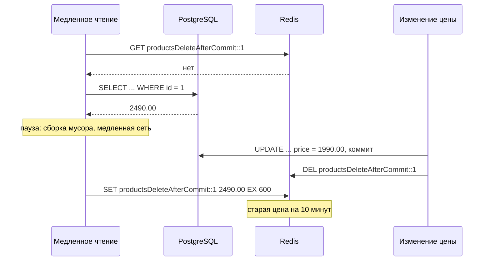

# Сценарий 5. Удаление после коммита и гонка в Redis

Тест: `src/test/java/io/github/olaaa/distributedcachelab/scenario/Scenario5DeleteAfterCommitTest.java`.
Сервисы: `DeleteAfterCommitProductService` (кэш `productsDeleteAfterCommit`, `@Cacheable` и `@CacheEvict`) и `LeaseProductService` (ключи `productsLease::`, аренда `productsLease:lease::`, `LEASE_TTL` = 10 секунд). Пауза медленного чтения: `CacheWritePause`.
Ручная проверка: `http/05-delete-after-commit.http` и команды `curl` ниже.

Аренда (lease) — право записать значение в кэш, которое чтение получает при промахе и теряет, если значение тем временем изменили. Устаревшая запись (stale set) — запись в кэш значения, которое уже не совпадает с базой.

## Ситуация

Менеджер снижает цену «Чайника» с 2490.00 до 1990.00. Кэш устроен как обычно — cache-aside: чтение смотрит в Redis, при промахе читает базу и кладёт товар в Redis; изменение пишет в базу и удаляет ключ из Redis. Следующее чтение промахнётся и загрузит новую цену.

В Spring это стандартная связка: `@Cacheable` на чтении и `@CacheEvict` на изменении. Сценарий отвечает на два вопроса: в какой момент удалять ключ и хватает ли удаления.

## Почему удаление, а не обновление

Изменение могло бы сразу записать в Redis новое значение. Удаляют по двум причинам:

- Два почти одновременных изменения могут записать значения в Redis в другом порядке, чем закоммитили их в базу, и в кэше останется не последнее. С удалением порядок не важен: следующее чтение возьмёт то, что действительно лежит в базе. Тот же довод — в сценарии 5 caching-lab и в сценарии 4 здесь.
- Удаление идемпотентно: повторить его безопасно. Facebook в статье о memcache: «Мы удаляем данные из кэша, а не обновляем их, потому что удаление идемпотентно».

## Почему после коммита

Если удалить ключ до коммита — или внутри транзакции, до её конца, — любое чтение между удалением и коммитом промахнётся и прочитает базу. Изменение ещё не закоммичено, и при уровне изоляции READ COMMITTED, который в PostgreSQL по умолчанию, чтение его не видит: оно получит старую цену и положит её обратно в Redis. Окно для ошибки — вся длина транзакции.

Удаление после коммита это окно закрывает: чтение, которое началось после коммита, увидит новую цену.

В сервисе так и сделано:

```java
@Cacheable(CACHE_NAME)
public Mono<Product> findById(long id) {
    return source.load(id).flatMap(cacheWritePause::before);
}

@CacheEvict(cacheNames = CACHE_NAME, key = "#id")
public Mono<Boolean> changePrice(long id, BigDecimal price) {
    return repository.updatePrice(id, price).map(updatedRows -> updatedRows > 0);
}
```

`UPDATE` идёт без явной транзакции и коммитится сразу. `@CacheEvict` по умолчанию удаляет ключ после метода. Javadoc `beforeInvocation`: «По умолчанию false: удаление из кэша выполняется после того, как вызов метода успешно завершился». Для метода, который возвращает `Mono`, «после метода» — когда `Mono` завершился, то есть после `UPDATE`.

Если изменение идёт в транзакции, удаление нужно привязать к её коммиту. Для обычного, не реактивного стека в Spring есть `TransactionAwareCacheDecorator` (у `RedisCacheManager` включается через `transactionAware()`): «само добавление, удаление и очистка кэша выполняются только в фазе после коммита успешной транзакции». Он опирается на `TransactionSynchronizationManager`, привязанный к потоку, поэтому для реактивных транзакций он, вероятно, не сработает — это вывод из устройства, в лаборатории не проверялся.

## Гонка, которую удаление после коммита не закрывает



Чтение прочитало базу до коммита, а записало в Redis после удаления. Удалять уже нечего: ключ появился позже. Следующие 10 минут все реплики отдают 2490.00, хотя в базе 1990.00.

Facebook называет это stale set: «Устаревшая запись случается, когда веб-сервер записывает в memcache значение, которое уже не совпадает с последним значением, подлежащим кэшированию. Так бывает, когда одновременные изменения memcache выполняются не в том порядке».

Окно маленькое: нужна пауза в чтении ровно между `SELECT` и `SET`. Но под нагрузкой такие паузы случаются, а цена ошибки — весь срок жизни записи. Это вывод, не замер. Чем длиннее срок жизни, тем дороже такая гонка.

Встроенной защиты в Redis нет: `SET` записывает значение, не зная, что ключ только что удалили. Spring Cache её тоже не даёт. Поэтому защиту пишут сами.

## Аренда

В memcache у Facebook защита встроена в сам сервер кэша — аренда:

- «Аренда — это 64-битный маркер, привязанный к тому ключу, который клиент изначально запросил.»
- «Записывая значение в кэш, клиент передаёт маркер аренды. По маркеру memcached проверяет, нужно ли сохранять данные, и так разрешает спор одновременных записей.»
- «Проверка не пройдёт, если memcached аннулировал маркер аренды, потому что получил запрос на удаление этого ключа.»

В Redis аренды нет, но её можно собрать из двух вещей: `SET … NX` и Lua-скрипта. `LeaseProductService` делает так:

1. Чтение промахнулось и берёт аренду: `SET productsLease:lease::1 <маркер> NX` со сроком 10 секунд. `NX` — записать, только если ключа нет: аренда у одного чтения.
2. Только после этого читает базу.
3. Изменение цены после коммита удаляет и значение, и аренду одной командой: `DEL productsLease::1 productsLease:lease::1`.
4. Чтение пишет товар в Redis Lua-скриптом: записать, только если аренда на месте и маркер свой.

```lua
if redis.call('GET', KEYS[2]) == ARGV[1] then
    redis.call('SET', KEYS[1], ARGV[2], 'PX', ARGV[3])
    redis.call('DEL', KEYS[2])
    return 1
end
return 0
```

Если между `SELECT` и записью цену изменили, аренды уже нет, скрипт возвращает 0, и старая цена в Redis не попадает.

**Почему аренду берут до чтения базы.** Пусть чтение увидело старую цену. Значит, оно читало базу до коммита. Удаление идёт после коммита, а аренду чтение взяло до `SELECT` — значит, аренда уже была на месте, когда пришло удаление, и удаление её сняло. Если бы аренду брали после `SELECT`, чтение могло бы взять её уже после удаления и записать старую цену.

**Почему проверка и запись — один скрипт.** Если сначала `GET` аренды, а потом `SET` значения отдельными командами, удаление может пройти между ними, и устаревшая запись проскочит. Lua-скрипт Redis выполняет целиком, ничего не вклинится. Документация Redis: «Redis гарантирует атомарное выполнение скрипта. Пока скрипт выполняется, вся остальная работа сервера заблокирована».

**Что ещё следует из устройства:**

- Чтение, которому аренда не досталась — её держит другое чтение того же товара, — загружает товар из базы, но в Redis не пишет. При одновременных промахах пишет одно. Facebook заставляет остальных ещё и подождать и повторить чтение — это уже защита от лавины промахов, сценарий 6.
- Срок аренды — 10 секунд, с запасом больше обычной загрузки. Если загрузка дольше, аренда истечёт, и запись не состоится: товар просто не попадёт в кэш, следующее чтение попробует снова.
- Цена: на промахе — лишняя команда `SET NX` и скрипт вместо `SET`. На попадании — ничего.

Аренда не поможет, если базу меняют в обход приложения — миграцией, вручную, другим сервисом: удалять ключ тогда некому, спасает только срок жизни.

## Другие способы

Кратко, в лаборатории не проверялись — это выводы из устройства:

- **Короткий срок жизни.** Устаревшая запись живёт не дольше срока. Гонку не устраняет, ограничивает вред.
- **Повторное удаление с задержкой.** Удалить ключ после коммита и ещё раз через несколько секунд. Закрывает гонку, если медленное чтение успело записать до второго удаления. Задержку приходится угадывать, и между записью и вторым удалением старая цена всё равно видна.
- **Версии.** Хранить в значении версию строки из базы и записывать только более новую, а при изменении оставлять вместо значения «надгробие» с новой версией. Нужна колонка версии в таблице и скрипт сравнения версий.

## Что проверяют тесты

Пауза медленного чтения в тестах — 1 секунда: за это время изменение цены проходит целиком. Тест ждёт, пока чтение встанет на паузу (`CacheWritePause.pausedWrites()`), и только потом меняет цену, поэтому гонка воспроизводится каждый раз.

`deleteAfterCommitMakesNextReadLoadNewPrice`: обычный случай. Чтение положило товар в Redis, изменение цены удалило ключ, следующее чтение загрузило 1990.00. Обращений к источнику — два.

`slowReadPutsOldPriceBackAfterDelete`: гонка.

1. Медленное чтение прочитало старую цену и встало на паузу.
2. Изменение цены: `UPDATE`, коммит, удаление ключа — ключа в Redis нет.
3. Чтение закончило паузу и записало 2490.00 в Redis.
4. В базе 1990.00, а кэш отдаёт 2490.00, и срок жизни у ключа — больше 9 минут. Обращение к источнику — одно: второе чтение взяло старую цену из Redis.

`leaseRejectsStaleWriteAfterDelete`: та же гонка с арендой.

1. Медленное чтение взяло аренду, прочитало старую цену и встало на паузу.
2. Изменение цены удалило значение и аренду.
3. Чтение отдало вызвавшему старую цену — оно её прочитало, — но записать в Redis не смогло: `staleWritesRejected` = 1, значения в Redis нет.
4. Следующее чтение загрузило 1990.00 и положило в Redis. Обращений к источнику — два.

`leaseLetsOrdinaryMissFillCache`: без гонки аренда не мешает. Промах положил товар в Redis со сроком 10 минут, аренда после записи снята, второе чтение — из Redis.

Весь набор тестов лаборатории, 18 тестов, прогнан три раза подряд без падений.

## Попробовать вручную

Запустить приложение: `mvn spring-boot:run`. Нужно, чтобы изменение цены прошло, пока медленное чтение ждёт, поэтому удобнее из терминала:

```bash
curl -s -X POST localhost:8080/lab/reset
curl -s -X POST 'localhost:8080/lab/cache-write-pause?seconds=5'
curl -s 'localhost:8080/products/1?via=DELETE_AFTER_COMMIT' &
sleep 1
curl -s -X PUT -H 'Content-Type: application/json' -d '{"price":1990.00}' \
  'localhost:8080/products/1/price?via=DELETE_AFTER_COMMIT'
wait
curl -s -X POST 'localhost:8080/lab/cache-write-pause?seconds=0'
curl -s 'localhost:8080/products/1?via=DELETE_AFTER_COMMIT'
docker compose exec redis redis-cli GET productsDeleteAfterCommit::1
```

То же с арендой: `via=LEASE` в чтениях и в изменении, ключ `productsLease::1`. В конце вернуть цену 2490.00. В `http/05-delete-after-commit.http` — те же шаги для IntelliJ HTTP Client: медленное чтение запустить и, пока оно ждёт, запустить изменение цены.

Результат такого прогона:

```text
===== DELETE_AFTER_COMMIT
change: HTTP 204
slow read: {"id":1,"name":"Чайник","price":2490.00}
next read: {"id":1,"name":"Чайник","price":2490.00}
redis GET productsDeleteAfterCommit::1: {"id":1,"name":"Чайник","price":2490.00}
redis TTL: 600
===== LEASE
change: HTTP 204
slow read: {"id":1,"name":"Чайник","price":2490.00}
next read: {"id":1,"name":"Чайник","price":1990.00}
redis GET productsLease::1: {"id":1,"name":"Чайник","price":1990.00}
redis TTL: 600
```

Без аренды в Redis на 10 минут осталась старая цена, с арендой — новая.

## Что важно заметить

- Удалять — после коммита: удаление до коммита оставляет окно длиной во всю транзакцию.
- Удаление после коммита не закрывает гонку с чтением, которое прочитало базу до коммита и записало в Redis после удаления. Старая цена тогда живёт весь срок жизни.
- Ни Redis, ни Spring Cache от этого не защищают. Защита — аренда: взять её до чтения базы, снимать при изменении, писать только при своей аренде, атомарно, Lua-скриптом.
- Срок жизни остаётся страховкой в любом случае: от изменений в обход приложения и от ошибок в самой защите.

## Как сказать на собеседовании

«При изменении удаляю ключ из кэша, а не обновляю: удаление идемпотентно и не зависит от порядка. Удаляю после коммита — иначе чтение внутри окна транзакции вернёт в кэш старое значение. Но и это не всё: чтение, которое прочитало базу до коммита и записало в кэш после удаления, положит старое значение на весь срок жизни. В Redis от этого защиты нет, поэтому делаю аренду, как в memcache у Facebook: при промахе беру в Redis ключ-аренду с маркером через `SET NX`, потом читаю базу, а пишу Lua-скриптом, только если моя аренда на месте; изменение после коммита удаляет и значение, и аренду. Срок жизни при этом оставляю — как страховку».

## Источники

- Rajesh Nishtala и др. — [Scaling Memcache at Facebook](https://www.usenix.org/system/files/conference/nsdi13/nsdi13-final170_update.pdf), NSDI 2013: раздел 2 (удаление вместо обновления), раздел 3.2.1 «Leases».
- Redis — [Scripting with Lua](https://redis.io/docs/latest/develop/programmability/eval-intro/), [SET](https://redis.io/docs/latest/commands/set/).
- Spring Framework — javadoc [`CacheEvict.beforeInvocation`](https://docs.spring.io/spring-framework/docs/current/javadoc-api/org/springframework/cache/annotation/CacheEvict.html), [`TransactionAwareCacheDecorator`](https://docs.spring.io/spring-framework/docs/current/javadoc-api/org/springframework/cache/transaction/TransactionAwareCacheDecorator.html).
- Spring Data Redis 4.1.2: `ReactiveRedisTemplate.execute(RedisScript, …)`, `ReactiveValueOperations.setIfAbsent`.
